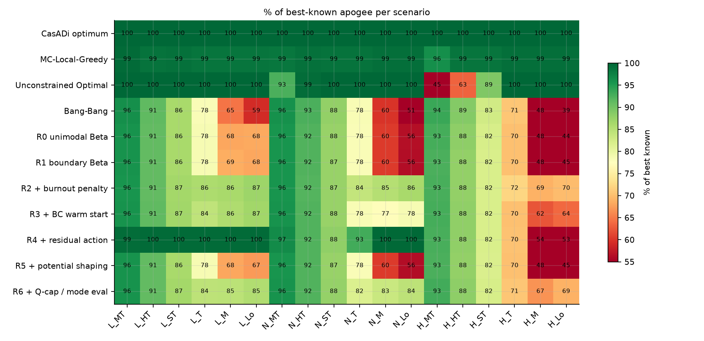

# Goddard RL — beating a baseline PPO agent on the constrained Goddard rocket

Reproduction and improvement of Section 7 of *CARL: Chat Assisted Reinforcement
Learning* (Das et al., [arXiv:2610.31014](https://arxiv.org/abs/2610.31014)).

The task is the classic Goddard rocket: maximise apogee by choosing throttle over
time, subject to a dynamic-pressure limit (`q = ½ρv² <= Qmax`). The paper's claim is
that a **boundary-seeking Beta policy** is what lets RL escape the premature
convergence of a standard unimodal policy head. This repository reproduces the
environment and the non-RL baselines to within a few metres on the paper's table,
retrains the RL ladder from scratch, and adds five incremental fixes — including one
(the residual action around the singular arc) that closes most of the remaining gap.

**Live dashboard:** [vishwajeettoppo.github.io/goddard-rl](https://vishwajeettoppo.github.io/goddard-rl/) ·
**Slides:** [slides.html](https://vishwajeettoppo.github.io/goddard-rl/slides.html) ·
**Report:** [REPORT.md](REPORT.md)

```
$ python src/evaluate.py --ablations all      # 18 held-out scenarios, deterministic
```

<!-- results:start -->
| Method | Kind | Mean apogee (m) | Mean % best | Worst % best | Light | Nominal | Heavy |
| --- | --- | ---: | ---: | ---: | ---: | ---: | ---: |
| R4 · residual action | RL | 18,074 | **89.3** | 53.5 | 99.6 | 94.9 | 73.4 |
| R2 · burnout penalty | RL | 18,532 | **85.4** | 69.0 | 88.7 | 88.4 | 78.9 |
| R6 · Q-cap / mode eval | RL | 18,363 | **84.6** | 66.6 | 88.0 | 87.5 | 78.2 |
| R3 · BC warm start | RL | 17,944 | **83.3** | 62.4 | 88.4 | 84.9 | 76.5 |
| R0 · unimodal Beta | RL | 16,592 | **76.9** | 44.4 | 81.4 | 78.4 | 71.0 |
| R1 · boundary Beta | RL | 16,587 | **76.9** | 44.9 | 81.4 | 78.3 | 71.0 |
| R5 · potential shaping | RL | 16,582 | **76.8** | 45.0 | 81.1 | 78.3 | 71.0 |
| CasADi optimum | baseline | 22,766 | **100.0** | 100.0 | 100.0 | 100.0 | 100.0 |
| MC-Local-Greedy | baseline | 22,468 | **98.8** | 96.2 | 98.9 | 98.9 | 98.6 |
| Unconstrained Optimal | baseline | 20,026 | **93.8** | 44.8 | 100.0 | 98.7 | 82.9 |
| Bang-Bang | baseline | 16,427 | **75.8** | 38.6 | 79.3 | 77.6 | 70.4 |

Best learned policy: **R4 · residual action** at **89.3%** of best-known apogee on average, with a worst-case scenario at 53% and 73% on the heavy-fuel subset.
<!-- results:end -->




## What is here

| Path | Contents |
| --- | --- |
| `src/env.py` | Shared RK4 evaluator (exact fuel-out split, binary-search max-Q clamp with 5% drag surcharge) plus a Numba-parallel batched trainer. |
| `src/features.py` | CARL's 12-D observation, the two burnout features, monotone burnout-target calibration, R5 potential. |
| `src/baselines.py` | Bang-Bang, MC-Local-Greedy (30 segments + coordinate descent), Unconstrained Optimal (bang–singular arc–coast), CasADi direct optimum. |
| `src/ppo.py` | Beta actor-critic, GAE, clipped PPO, analytic Beta entropy, mean/mode/sample evaluation. |
| `src/train.py` | Ablation ladder R0–R6 with domain randomisation, auto-reset rollouts and JSONL logs. |
| `src/evaluate.py` | 18-scenario deterministic evaluation, ablation table, percent-of-best-known. |
| `src/plots.py` | Learning curves, entropy collapse, ablation bars, heatmap, trajectory profiles. |
| `scripts/` | `run_baselines.py`, `run_all_training.sh`, `build_site.py`, `validate_env.py`. |
| `configs/` | `scenarios.yaml` (18 scenarios + paper Table 7), `train.yaml` (PPO + randomisation). |
| `notebooks/demo.ipynb` | Live demo: pick a scenario, run every method, plot the three-panel profile. |
| `web/`, `slides/` | Static dashboard and slide deck (deployed with GitHub Pages). |
| `docs/reproduction.md` | Exact numbers, and where the paper could not be reproduced. |

## Setup

```bash
python -m venv .venv && source .venv/bin/activate     # Python 3.11+
pip install -r requirements.txt
git clone https://github.com/srdas/carl reference/carl  # read-only reference
```

CasADi is only needed for the optional direct-collocation optimum; everything else
runs on NumPy, Numba and PyTorch.

## Reproduce

```bash
# 1. Sanity-check the physics against paper Table 7 (Bang-Bang + unconstrained optimal)
python scripts/validate_env.py

# 2. All non-RL baselines on the 18 scenarios -> results/baselines.csv (about 1 min)
python scripts/run_baselines.py --no-resume

# 3. Train the R0-R6 ladder, 3 seeds each -> results/checkpoints (about 1 h on a laptop)
bash scripts/run_all_training.sh 120 3

# 4. Evaluate, tabulate, plot -> results/eval_rl.csv, results/ablation_table.csv, results/figures
python src/evaluate.py --ablations all
python src/plots.py
```

Everything is deterministic given the seed; the environment is not stochastic, so a
single rollout per scenario is enough once the agent is trained.

## The ablation ladder

| ID | Change | Motivated by |
| --- | --- | --- |
| R0 | Base 12-D observation, unimodal Beta (`ε = 1`) | CARL initial run |
| R1 | Boundary-mode Beta (`ε = 0.01`) | CARL's key finding |
| R2 | + burnout features, one-sided early-burnout penalty | CARL revisit 1 |
| R3 | + behaviour cloning from the singular-arc expert | not attempted in the paper |
| R4 | + residual action `u = clip(u_singular + δ)` | this work |
| R5 | potential-based energy shaping instead of the penalty | Ng et al. 1999 |
| R6 | actor-side `Qmax` cap in training + mode-based eval | fixes Beta train/eval mismatch |

Training uses a domain randomisation wider than the evaluation grid
(`m_fuel_0 ∈ [300, 5000] kg`, `Tmax ∈ [1e5, 3e5] N`, `cd ∈ [1, 2]`,
`Qmax ∈ [3500, 60000] Pa`) with the 18 evaluation pairs excluded, so nothing in
the table is trained on.

## Findings

1. **The evaluator is the easy part to get subtly wrong.** Fuel-out splitting,
   clamp depth and where the 5% surcharge is applied all move `H_MT` by hundreds of
   metres. Ours lands within 0.3% of the paper there and within ~1 m everywhere else.
2. **The residual action is the single biggest improvement.** `u = clip(u_singular + δ)`
   lifts the agent from 76.9% to **89.3%** of best-known apogee, with 99.6% on light
   fuel and 94.9% on nominal scenarios. On `N_M` it matches the unconstrained optimum
   (15,756 m) and on `L_*` it reaches ~3,490 m against 3,372 m for Bang-Bang.
3. **The burnout penalty is what fixes heavy fuel.** R2/R6 reach 34–35 km on `H_M`
   and `H_Lo` where R4 stalls at 26–27 km; heavy episodes are long and burning early
   in dense air is expensive. The two fixes are complementary.
4. **The boundary head is not a free win at this budget.** After 120 updates R0 and R1
   both sit at 76.9% (bang-bang quality). The difference shows up in policy shape and
   entropy (see `results/figures/policy_shapes.png`), not in apogee; the paper's
   separation needed 500–1000 updates.
5. **BC warm start buys speed, not quality.** It starts from a near-deterministic
   singular-arc imitation (entropy −2.3 nats) and finishes at 83.3%: better than R0/R1,
   worse than R2, and with exploration already spent.
6. **Potential shaping was neutral here (76.8%).** With `γ = 1` the shaping telescopes
   to a constant only if the potential is zero on terminal states — we enforce that —
   and the altitude reward is already dense enough that nothing is gained.
7. **Q-cap + mode evaluation (R6)** is the second-best heavy-fuel variant and removes
   the Beta train/eval mismatch, at a small cost on light fuel.

Full write-up: [`REPORT.md`](REPORT.md). Exact deviations from the paper:
[`docs/reproduction.md`](docs/reproduction.md).

## Presentations

* Slides: `slides/index.html` (open in a browser, arrow keys navigate).
* Dashboard: `web/index.html`, published with GitHub Pages.
* Notebook: `notebooks/demo.ipynb`.

## References

* Das et al., *CARL: Chat Assisted Reinforcement Learning*, arXiv:2610.31014, Section 7.
* Tsiotras & Kelley (1991); Bonnans, Martinon & Trélat (2008) — Goddard problem.
* Schulman et al. (2017) — PPO. Ng, Harada & Russell (1999) — potential-based shaping.
