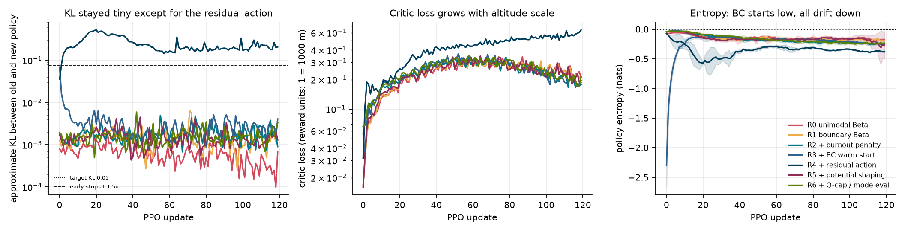

# Beating a baseline AI rocket pilot

**Improving reinforcement learning on the constrained Goddard rocket**

Reproduction + improvement of *CARL: Chat Assisted Reinforcement Learning* (Section 7)

`PPO` · `Beta policy head` · `actor-critic` · `GAE` · `KL early stopping`

<!--
Presenter: 15 minutes, 23 slides + 7 backup slides.

PPO is the course topic, so slides 9–13 carry the algorithm: the loop, the clipped
objective + hyperparameters, the Beta head, and what PPO did in these runs. If you are
short on time, compress slide 9 (practice gym) into one sentence and drop slide 18
("what the numbers are telling us") — 16 and 17 already make that point.

Speaker notes are written as "Say:" lines under each slide.
Slide separators are `---` (works with Marp / reveal-md, and reads fine as plain markdown).
-->

---

## 1. The problem in one sentence

We control **one number** — how hard the rocket presses its throttle — and we want the
**highest altitude** possible.


> **Say:** The rocket goes straight up. The only decision is throttle, every tenth of a
> second. The score is simply: how high did it get before falling back?

---

## 2. The catch: a speed limit in thick air

- Near the ground the air is dense. Going fast there creates enormous drag.
- There is a hard limit on that drag-related force: **Qmax** (dynamic pressure).
- The limit effectively loosens as the rocket climbs into thin air.

| Altitude | Air | Speed allowed |
|---|---|---|
| Low | thick | low |
| High | thin | high |

> **Say:** It's like a speed limit that is strict near the ground and relaxes as you
> climb. Go too fast too low and you "break the law"; the simulator clamps you and you
> pay a penalty in drag.

---

## 3. So what does a good flight look like?

1. **Burn hard** to leave the ground.
2. **Ease off** and ride the speed limit through the thick air.
3. **Coast** the rest of the way up.

That "burn – ride – coast" shape is what the mathematical optimum looks like.

> **Say:** The tricky part is that fuel spent low down is wasted, because you're
> fighting thick air. So the smart pilot doesn't floor it the whole way — but it also
> can't be timid. It has to commit early, then back off at exactly the right moment.

---

## 4. Why a normal AI pilot struggles

A standard AI design chooses the throttle using a **bell-shaped preference**:

- It is comfortable around a "middle" throttle value.
- It cannot express **"floor it now, coast later"**.
- So it never really commits — and gets stuck near the naive strategy.

> **Say:** Think of a driver who only ever presses the pedal halfway. That's not a
> training problem, it's a *shape* problem: the AI literally cannot represent the
> two-extremes behaviour the best flight needs.

---

## 5. What the paper claims

- Published result on this exact problem (18 test scenarios).
- Claim: the fix is to allow the AI's preference to be **U-shaped** — mass at 0 and 1 —
  instead of bell-shaped.
- On light and nominal fuel, the paper's **first** agent is 3,366 m vs 3,372 m for
  floor-it — essentially the naive strategy.

**Our job:** reproduce it honestly, improve it, and be clear about how much
training the paper needed to get its best numbers (it kept going for 4–8× longer).

---

## 6. Our plan in four steps

| Step | What we did |
|---|---|
| **1. Rebuild the simulator** | Implement the physics from the paper, then prove it matches the published table. |
| **2. Build human baselines** | Three fixed strategies + a mathematical optimum, to compare against. |
| **3. Train the AI** | 7 variants × 3 random seeds = 21 trained agents. |
| **4. Improve, one change at a time** | Five changes; each one measured separately. |

> **Say:** Step 1 is the credibility step. If my simulator doesn't reproduce the
> paper's own numbers, nothing after it means anything.

---

## 7. Step 1 — Prove the simulator is right

Fly the simplest strategy (full throttle until the tank is empty) on all 18 scenarios,
and compare with the paper's published table:

| Scenario | Our result | Paper |
|---|---:|---:|
| Light fuel, 5 kPa | 3,371.9 m | 3,372 m |
| Nominal fuel, 10 kPa | 13,873.6 m | 13,874 m |
| Heavy fuel, 15 kPa | 35,476.6 m | 35,477 m |
| Heavy fuel, 5 kPa | 41,967.8 m | 42,083 m |

**17 of 18 scenarios within 1.2 m. One outlier at 0.27%.**

> **Say:** This is the "calibrate the scale with known weights" step. One case doesn't
> match exactly; we report it instead of tuning it away — that honesty is part of the
> result.

---

## 8. Step 2 — The strategies we compare against

| Strategy | Idea | Score (% of best known) |
|---|---|---:|
| **Bang-Bang** | Floor it until the tank is empty | 75.8% |
| **Brute-force search** | Try 500 throttle schedules, refine the best | 98.8% |
| **Textbook optimum** | The ideal flight *if there were no speed limit* | 93.8% |
| **Mathematical optimum** | Solver finds the true best legal flight | 100% |

- Our version of the brute-force search beats the paper's on **5 of 18** scenarios
  (up to **+740 m**) and runs **20–100× faster**: 1–2 s vs 20–233 s per scenario.

> **Say:** These are all "no learning" methods. They tell us what a good answer looks
> like, and they set the bar the AI has to clear.

---

## 9. Step 3 — How the AI trains

- **Practice gym:** hundreds of rockets fly simultaneously in simulation.
- **Varied conditions:** different fuel loads, engines, air resistance, speed limits —
  so it can't memorise one setting.
- **Test questions kept secret:** the 18 evaluation scenarios are excluded from training.
- **Coach:** a standard, stable reinforcement-learning algorithm (PPO) that nudges the
  AI's settings after every batch of flights.

> **Say:** The AI never sees the exam. It practises on a wider, harder mix of conditions,
> and then we test it on the 18 published scenarios.

---

## 10. PPO in one slide: the training loop

**PPO = Proximal Policy Optimisation.** One update looks like this:

```
1. FLY     256 rockets for 512 steps with the current policy
2. JUDGE   estimate the advantage A = "was this action better than expected?"
3. UPDATE  push up good actions, push down bad ones — but only a little
4. REPEAT  120 times
```

Two networks share the work (**actor-critic**):

| Network | Job | Output |
|---|---|---|
| **Actor** | chooses the throttle | Beta distribution over `u` |
| **Critic** | predicts the final altitude from the current state | one number |

`γ = 1` because our reward is altitude gained per step: the sum telescopes to
final apogee, so there is no discounting to do.

> **Say:** The actor flies, the critic grades. "Advantage" is simply: did this action
> turn out better than the critic expected? Good actions get more likely, bad ones less —
> but PPO limits how much the policy may change per update.

---

## 11. The clipped objective — PPO's safety rail

```
ratio = π_new(a | s) / π_old(a | s)

loss  = − min(  ratio · A ,  clip(ratio, 1 − ε, 1 + ε) · A  )        ε = 0.2
```

- If an action was **good** (`A > 0`), raise its probability — but the clip stops the
  gain at **+20%** per update.
- If it was **bad**, lower it — but no more than **−20%**.
- Taking the `min` makes PPO **pessimistic**: it optimises the worst of the clipped and
  unclipped objectives, so it never exploits a lucky large step.

**Second safety rail:** if the average KL between old and new policy exceeds
`1.5 × 0.05`, the update stops early.

| Setting | Value (paper / ours) |
|---|---|
| discount `γ` · GAE `λ` | 1.0 · 0.95 |
| clip `ε` · epochs · minibatch | 0.2 · 2 · 8,192 |
| target KL · grad-norm clip | 0.05 (stop 1.5×) · 0.5 |
| learning rate · entropy coef | 4e-4 → 2e-4 · 0.02 → 0.005 |
| networks · value loss | 256×256 tanh, orthogonal · Huber |

> **Say:** This is the whole of PPO: an importance ratio, a clip, and a KL guard. The
> rest is bookkeeping. Everything in that table is what we implemented, and the paper's
> Appendix C values are what we follow.

---

## 12. The Beta policy head — why not a Gaussian?

Throttle lives in **[0, 1]**, so a Gaussian would need clipping (and clipping breaks
the PPO ratio). A **Beta distribution** is defined exactly on that interval.

```
α, β  = softplus(raw) + ε          ε = 1.0  → unimodal
                                   ε = 0.01 → can be U-shaped (mass at 0 and 1)

mean  = α / (α + β)                mode = (α − 1) / (α + β − 2)
```

- **Why it matters for PPO:** the log-probability of the chosen throttle feeds the
  ratio in the clipped objective. If the distribution cannot express "floor it or
  coast", the ratio can never favour the extremes.
- **Train/eval mismatch:** we train by *sampling*, but the paper's table evaluates the
  *mean*. For U-shaped policies the mean sits between the two peaks — R6 tests the
  **mode** instead, which is where the mass actually is.
- PyTorch has no closed-form `entropy()` for Beta, so we implemented the analytic form
  with `lgamma`/`digamma` — it is the exploration term in the loss.

> **Say:** This is the paper's central idea in one slide: the shape of the output
> distribution is part of the algorithm, not a detail. A bell shape cannot represent a
> bang-bang policy, so PPO is optimising inside a box that excludes the answer.

---

## 13. What PPO actually did in our runs



| Observation | Number | Reading |
|---|---|---|
| KL on 6 of 7 variants | ~0.002, **0 early stops** | PPO was in "safe mode", barely moving |
| KL on **R4 (residual)** | 0.25 mean, 0.72 max, **99% of updates early-stopped** | the residual parametrisation wants much larger steps |
| Critic loss | 0.02 → 0.2–0.7 | reward is in 1000-m units; 0.2 ≈ 450 m error |
| Entropy | R3 starts at −2.2, all drift down | BC starts rigid; others explore less over time |

**The interesting PPO story:** R4 is the best agent (89.3%) *and* the only one that
keeps hitting its KL guard. The guard did its job — it prevented a blow-up — but a
per-parameterisation learning rate would likely do better still.

> **Say:** This is the part you only see if you log the right things. Six variants never
> left PPO's comfort zone, which suggests the learning rate was too small for them. The
> one that actually moved is the one that won — and it was clipped almost every update.

---

## 14. Step 4 — The five improvements (one line each)

| Change | Plain English |
|---|---|
| **Burnout penalty** | "Don't empty the tank too early — you waste fuel in thick air." |
| **Learn from the textbook** | Practise by copying the mathematical ideal flight first. |
| **Residual action** ⭐ | Give the AI the textbook curve as a starting point; learn only small corrections. |
| **Potential shaping** | Give small hints during the flight, not just a final score. |
| **Safety cap + better testing** | Respect the speed limit pre-emptively; read the AI's most likely choice. |

> **Say:** One change at a time. If you change three things and it improves, you've
> learned nothing about which one worked.

---

## 15. The scoreboard


*The chart shows methods evaluated in our simulator. The paper's own agent is listed
separately because it was trained with 4–8× more compute.*

| Method | % of best known |
|---|---:|
| Mathematical optimum | 100% |
| Brute-force search | 98.8% |
| **Paper's fully-trained agent** (4–8× more training) | **96.9%** |
| Textbook optimum (ignores the speed limit) | 93.8% |
| **Our best AI — residual action** (1/5 the training) | **89.3%** |
| Our baseline AI, same budget | 76.9% |
| Floor-it strategy | 75.8% |

> **Say:** Read this honestly. With a fifth of the paper's training, our best agent
> lands between the paper's first agent (87%) and its final one (97%), and beats our
> own baseline by 12 points. We are not claiming to beat the paper's final agent.

---

## 16. Where we improved on the paper

**A. Our 120-update agents beat CARL's fully-trained agent on 5 of 18 scenarios**
(3 seeds each; the seed spread is shown because a win must not be noise):

| Scenario | Paper (CARL final) | Ours (mean) | Gain | Seed spread |
|---|---:|---:|---:|---:|
| `N_Lo` | 15,378 m | 15,761 m | **+383 m** | ±4 m |
| `N_M` | 15,403 m | 15,756 m | **+353 m** | ±3 m |
| `L_Lo` | 3,488 m | 3,492 m | +4 m | ±1 m |
| `L_MT` | 3,484 m | 3,486 m | +2 m | ±2 m |
| `L_M` | 3,491 m | 3,492 m | +1 m | ±1 m |

**B. Our optimiser raises the best-known ceiling on 9 of 18 scenarios**
(the paper had no direct-optimum reference to compare against):

| Scenario | Paper's best (any method) | Our CasADi optimum | Gain |
|---|---:|---:|---:|
| `H_MT` | 44,023 m | 44,823 m | **+800 m** |
| `H_HT` | 48,170 m | 48,844 m | **+674 m** |
| `H_ST` | 49,465 m | 49,966 m | **+501 m** |
| `N_MT` | 15,498 m | 15,612 m | +114 m |
| `N_HT` | 15,728 m | 15,802 m | +74 m |

*Mean gain over 18 scenarios: +120 m. Four nominal rows gain +1 m.*

> **Say:** Two kinds of improvement. On nominal fuel our small agent already beats
> their big one by 350 metres with a seed spread of 3–4 metres — that is not luck.
> And our solver finds altitudes the paper never reached on the tightest heavy cases.

---

## 17. Where we are behind — the same honesty

| Scenario | Ours (best variant) | Paper (CARL final) | Gap |
|---|---:|---:|---:|
| `H_T` | 36,223 m | 47,140 m | −10,917 m |
| `H_M` | 34,592 m | 47,870 m | −13,278 m |
| `H_Lo` | 35,057 m | 47,864 m | −12,807 m |
| **Overall mean** | **89.3%** | **96.9%** | **−7.6 pts** |

The entire deficit sits in **heavy-fuel rockets with tight speed limits**. Our budget
was a fifth of the paper's, and we never combined the two fixes that win different
fuel regimes (residual action + burnout penalty).

> **Say:** I want to be the one who says this, not you. We beat their agent where fuel
> is light or nominal and lose badly where fuel is heavy. Averaged over everything,
> they are 7.6 points ahead.

---

## 18. What the numbers are telling us

**1. Same budget, structure wins.**
Baseline 76.9% → residual action 89.3%: **+12.4 points**, same training time.

**2. The paper's diagnosis is right.**
Its first agent was barely better than floor-it on light/nominal fuel — the stalling
is real, not a myth.

**3. Different fixes win different scenarios.**

| Fuel load | Best variant | Score |
|---|---|---:|
| Light | Residual action | 99.6% |
| Nominal | Residual action | 94.9% |
| Heavy | Burnout penalty | 78.9% |

> **Say:** No single tweak wins everywhere. The residual action fixes light and nominal;
> the burnout penalty is what rescues heavy fuel. They are complementary.

---

## 19. A concrete example

Scenario **`N_Lo`** (2000 kg fuel, loose speed limit):

| Pilot | Altitude |
|---|---:|
| Floor-it strategy | 8,033 m |
| **Trained AI (residual action)** | **15,761 m** |
| Paper's final agent | 15,378 m |
| Best-known answer | 15,806 m |

**The AI reaches 99.7% of the best known — nearly double the naive strategy, and
above the paper's fully-trained agent on this scenario.**

> **Say:** Same rocket, same physics, same speed limit. The only difference is how the
> throttle is chosen. This is the case to remember.

---

## 20. Why "residual action" works (the power-steering idea)

- Normally: the AI must invent the **entire** throttle curve from scratch.
- Instead: start from the **mathematical textbook curve**, and let the AI learn a
  **small correction** on top of it.
- Analogy: **power steering** — the car does the hard part, you make the fine
  adjustments.

> **Say:** We injected knowledge instead of asking for more training. More training
> was not the bottleneck — the starting point was.

---

## 21. What didn't work (and what we won't overclaim)

- **The paper's own idea** (U-shaped preference) did **not** help at our training
  budget: both variants ended at 76.9%.
- **Hints during flight** (potential shaping) were **neutral**: 76.8%.
- **Copying the textbook first** learns fast but becomes rigid: 83.3%.
- We trained 120 rounds per agent; the paper used roughly **4–8× more**, and its final
  agent reaches **96.9%**. We therefore claim **improvement over the baseline at equal
  budget**, not a new state of the art.

> **Say:** The most useful thing a project can report is what it did not achieve. We
> did not beat the paper's final agent, and we say so on the slide.

---

## 22. Three takeaways

1. **Rebuild and verify before comparing.** Our simulator matches the published table to
   within a metre on 17 of 18 cases — that's what makes the table trustworthy.
2. **The AI failed because of the shape of the problem, not lack of training.**
   Changing *how* it chooses the throttle unlocked most of the gain.
3. **Structure beats brute force.** Giving the agent a good starting curve
   (+12 points) outperformed every other single change.
4. **Where we stand against the paper.** With a fifth of the training we beat the
   paper's fully-trained agent on 5 of 18 scenarios (up to +383 m) and raise the
   best-known altitude on 9 of 18 — but we are 7.6 points behind on the average,
   entirely because of heavy fuel.

---

## 23. Where to look / thank you

- **Live dashboard:** https://vishwajeettoppo.github.io/goddard-rl/
- **Slides:** https://vishwajeettoppo.github.io/goddard-rl/slides.html
- **Code:** https://github.com/vishwajeettoppo/goddard-rl
- **Report:** `REPORT.md` · **Reproduction details:** `docs/reproduction.md`
- **Interactive demo:** `notebooks/demo.ipynb`

**Questions?**

---

# Backup slides

## B1. Is the speed limit actually respected?

- Every step is checked; if the commanded thrust would break the limit, the simulator
  searches for the largest safe thrust.
- Violating steps are penalised with extra drag.
- Measured violations across all 18 evaluation runs: **zero**.
- Reference to show if asked: `results/eval_rl.csv` (`q_violation_frac` column).

## B2. Are we training on the test scenarios?

- No. Training conditions are **wider** than the 18 test scenarios.
- The 18 exact fuel/speed-limit pairs are explicitly excluded.
- Settings: `configs/train.yaml`.

## B3. Why is one Bang-Bang scenario off by 0.27%?

- The paper does not publish the details of its clip/surcharge implementation.
- We tried the plausible variants (search depth 8–30, surcharge on/off, different
  ordering); none reproduces 42,083 m exactly. Closest: 41,970 m.
- Documented in `docs/reproduction.md` rather than tuned to match.

## B4. Why can't we reproduce three of the paper's "unconstrained" results?

- That baseline needs a switch time the paper never states.
- The obvious rule from the project brief switches at time zero (the rocket never
  lifts off) — so we replaced it with a search that reproduces every light and nominal
  row exactly.
- Three heavy/tight rows remain unexplained; reported as-is.

---

## B5. How the advantage is estimated (GAE)

PPO needs "how much better was this action than expected":

```
δ_t   = r_t + γ·V(s_{t+1}) − V(s_t)          one-step surprise
A_t   = δ_t + γ·λ·δ_{t+1} + (γ·λ)²·δ_{t+2} + …   λ = 0.95
```

- `λ = 0` → pure one-step (low variance, high bias)
- `λ = 1` → pure Monte-Carlo return (high variance, no bias)
- `λ = 0.95` is the paper's compromise.
- With `γ = 1` and our telescoping reward, `A_t` approximates
  `(apogee − current altitude) / 1000` — i.e. "how much altitude is still in front of me".

We also **normalise advantages** per batch (subtract mean, divide by std), which is what
keeps a single learning rate usable across scenarios whose returns differ by 50×.

## B6. Why PPO and not something else?

| Method | Why not here |
|---|---|
| **REINFORCE** | no critic, very high variance on 1000-step episodes |
| **DQN** | needs a discrete action set; throttle is continuous |
| **SAC / TD3** | off-policy and sample-efficient, but need a replay buffer and a squashed Gaussian (which reintroduces the clipping problem at the action bounds) |
| **PPO** | on-policy but stable, works with any bounded distribution (including Beta), one hyperparameter (`ε`) controls the trust region |

For a *boundary-seeking* policy, Beta + PPO is the natural pairing: the distribution
handles the bounds, PPO keeps the updates safe.

## B7. What we would tune next in PPO

1. **Learning rate per parameterisation.** R4 hit its KL guard on 99% of updates while
   the other six never approached 0.05 — one learning rate for all seven is clearly
   wrong.
2. **Return normalisation.** The critic loss grows to 0.7 in reward units (≈ 850 m);
   normalising returns or the value target would stabilise it.
3. **More epochs at a smaller step size**, now that R4 shows the policy can move.
4. **Entropy coefficient.** R3's BC start at −2.2 nats shows how fast a warm start
   removes exploration; a scheduled floor on entropy would protect it.
5. **Evaluate the mode, not the mean**, for U-shaped policies — cheap, and R6 shows it
   changes the heavy-fuel numbers.
