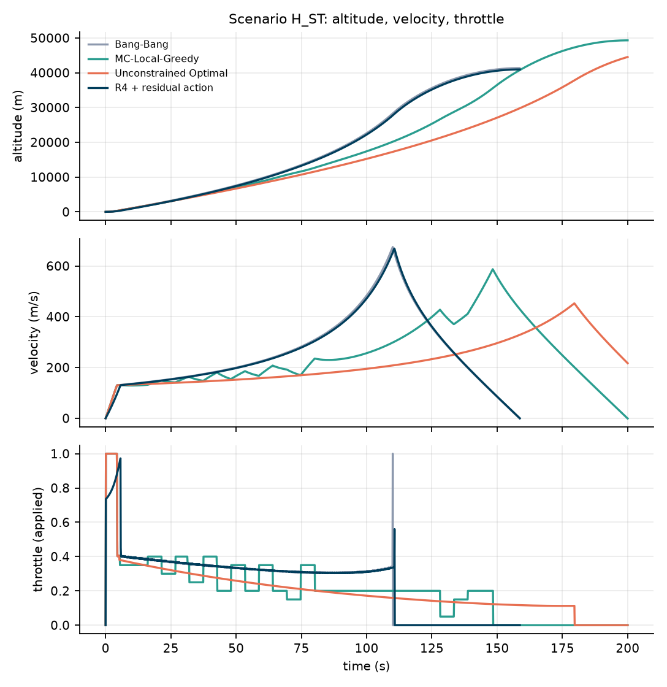
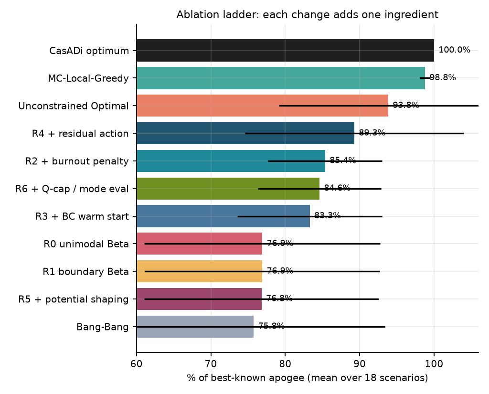

# Beating a baseline AI rocket pilot

**Improving reinforcement learning on the constrained Goddard rocket**

Reproduction + improvement of *CARL: Chat Assisted Reinforcement Learning* (Section 7)

<!--
Presenter: 12–15 minutes. Figures live in results/figures/.
Speaker notes are written as "Say:" lines under each slide.
Slide separators are `---` (works with Marp / reveal-md, and reads fine as plain markdown).
-->

---

## 1. The problem in one sentence

We control **one number** — how hard the rocket presses its throttle — and we want the
**highest altitude** possible.

> **Say:** The rocket goes straight up. The only decision is throttle, every tenth of a
> second. The score is simply: how high did it get before falling back?

---

## 2. The catch: a speed limit in thick air

- Near the ground the air is dense. Going fast there creates enormous drag.
- There is a hard limit on that drag-related force: **Qmax** (dynamic pressure).
- The limit effectively loosens as the rocket climbs into thin air.

| Altitude | Air | Speed allowed |
|---|---|---|
| Low | thick | low |
| High | thin | high |

> **Say:** It's like a speed limit that is strict near the ground and relaxes as you
> climb. Go too fast too low and you "break the law"; the simulator clamps you and you
> pay a penalty in drag.

---

## 3. So what does a good flight look like?

1. **Burn hard** to leave the ground.
2. **Ease off** and ride the speed limit through the thick air.
3. **Coast** the rest of the way up.

That "burn – ride – coast" shape is what the mathematical optimum looks like.

> **Say:** The tricky part is that fuel spent low down is wasted, because you're
> fighting thick air. So the smart pilot doesn't floor it the whole way — but it also
> can't be timid. It has to commit early, then back off at exactly the right moment.

---

## 4. Why a normal AI pilot struggles

A standard AI design chooses the throttle using a **bell-shaped preference**:

- It is comfortable around a "middle" throttle value.
- It cannot express **"floor it now, coast later"**.
- So it never really commits — and gets stuck near the naive strategy.

> **Say:** Think of a driver who only ever presses the pedal halfway. That's not a
> training problem, it's a *shape* problem: the AI literally cannot represent the
> two-extremes behaviour the best flight needs.

---

## 5. What the paper claims

- Published result on this exact problem (18 test scenarios).
- Claim: the fix is to allow the AI's preference to be **U-shaped** — mass at 0 and 1 —
  instead of bell-shaped.
- On light and nominal fuel, the paper's **first** agent is 3,366 m vs 3,372 m for
  floor-it — essentially the naive strategy.

**Our job:** reproduce it honestly, improve it, and be clear about how much
training the paper needed to get its best numbers (it kept going for 4–8× longer).

---

## 6. Our plan in four steps

| Step | What we did |
|---|---|
| **1. Rebuild the simulator** | Implement the physics from the paper, then prove it matches the published table. |
| **2. Build human baselines** | Three fixed strategies + a mathematical optimum, to compare against. |
| **3. Train the AI** | 7 variants × 3 random seeds = 21 trained agents. |
| **4. Improve, one change at a time** | Five changes; each one measured separately. |

> **Say:** Step 1 is the credibility step. If my simulator doesn't reproduce the
> paper's own numbers, nothing after it means anything.

---

## 7. Step 1 — Prove the simulator is right

Fly the simplest strategy (full throttle until the tank is empty) on all 18 scenarios,
and compare with the paper's published table:

| Scenario | Our result | Paper |
|---|---:|---:|
| Light fuel, 5 kPa | 3,371.9 m | 3,372 m |
| Nominal fuel, 10 kPa | 13,873.6 m | 13,874 m |
| Heavy fuel, 15 kPa | 35,476.6 m | 35,477 m |
| Heavy fuel, 5 kPa | 41,967.8 m | 42,083 m |

**17 of 18 scenarios within 1.2 m. One outlier at 0.27%.**

> **Say:** This is the "calibrate the scale with known weights" step. One case doesn't
> match exactly; we report it instead of tuning it away — that honesty is part of the
> result.

---

## 8. Step 2 — The strategies we compare against

| Strategy | Idea | Score (% of best known) |
|---|---|---:|
| **Bang-Bang** | Floor it until the tank is empty | 75.8% |
| **Brute-force search** | Try 500 throttle schedules, refine the best | 98.8% |
| **Textbook optimum** | The ideal flight *if there were no speed limit* | 93.8% |
| **Mathematical optimum** | Solver finds the true best legal flight | 100% |

> **Say:** These are all "no learning" methods. They tell us what a good answer looks
> like, and they set the bar the AI has to clear.

---

## 9. Step 3 — How the AI trains

- **Practice gym:** hundreds of rockets fly simultaneously in simulation.
- **Varied conditions:** different fuel loads, engines, air resistance, speed limits —
  so it can't memorise one setting.
- **Test questions kept secret:** the 18 evaluation scenarios are excluded from training.
- **Coach:** a standard, stable reinforcement-learning algorithm (PPO) that nudges the
  AI's settings after every batch of flights.

> **Say:** The AI never sees the exam. It practises on a wider, harder mix of conditions,
> and then we test it on the 18 published scenarios.

---

## 10. Step 4 — The five improvements (one line each)

| Change | Plain English |
|---|---|
| **Burnout penalty** | "Don't empty the tank too early — you waste fuel in thick air." |
| **Learn from the textbook** | Practise by copying the mathematical ideal flight first. |
| **Residual action** ⭐ | Give the AI the textbook curve as a starting point; learn only small corrections. |
| **Potential shaping** | Give small hints during the flight, not just a final score. |
| **Safety cap + better testing** | Respect the speed limit pre-emptively; read the AI's most likely choice. |

> **Say:** One change at a time. If you change three things and it improves, you've
> learned nothing about which one worked.

---

## 11. The scoreboard

*The chart shows methods evaluated in our simulator. The paper's own agent is listed
separately because it was trained with 4–8× more compute.*

| Method | % of best known |
|---|---:|
| Mathematical optimum | 100% |
| Brute-force search | 98.8% |
| **Paper's fully-trained agent** (4–8× more training) | **96.9%** |
| Textbook optimum (ignores the speed limit) | 93.8% |
| **Our best AI — residual action** (1/5 the training) | **89.3%** |
| Our baseline AI, same budget | 76.9% |
| Floor-it strategy | 75.8% |

> **Say:** Read this honestly. With a fifth of the paper's training, our best agent
> lands between the paper's first agent (87%) and its final one (97%), and beats our
> own baseline by 12 points. We are not claiming to beat the paper's final agent.

---

## 12. What the numbers are telling us

**1. Same budget, structure wins.**
Baseline 76.9% → residual action 89.3%: **+12.4 points**, same training time.

**2. The paper's diagnosis is right.**
Its first agent was barely better than floor-it on light/nominal fuel — the stalling
is real, not a myth.

**3. Different fixes win different scenarios.**

| Fuel load | Best variant | Score |
|---|---|---:|
| Light | Residual action | 99.6% |
| Nominal | Residual action | 94.9% |
| Heavy | Burnout penalty | 78.9% |

**4. The remaining gap is heavy rockets with the strictest speed limits.**
That's the honest frontier for future work.

> **Say:** No single tweak wins everywhere. The residual action fixes light and nominal;
> the burnout penalty is what rescues heavy fuel. They are complementary.

---

## 13. A concrete example

Scenario **`N_Lo`** (2000 kg fuel, loose speed limit):

| Pilot | Altitude |
|---|---:|
| Floor-it strategy | 8,033 m |
| **Trained AI (residual action)** | **15,761 m** |
| Paper's final agent | 15,378 m |
| Best-known answer | 15,806 m |

**The AI reaches 99.7% of the best known — nearly double the naive strategy, and
above the paper's fully-trained agent on this scenario.**

> **Say:** Same rocket, same physics, same speed limit. The only difference is how the
> throttle is chosen. This is the case to remember.

---

## 14. Why "residual action" works (the power-steering idea)

- Normally: the AI must invent the **entire** throttle curve from scratch.
- Instead: start from the **mathematical textbook curve**, and let the AI learn a
  **small correction** on top of it.
- Analogy: **power steering** — the car does the hard part, you make the fine
  adjustments.

> **Say:** We injected knowledge instead of asking for more training. More training
> was not the bottleneck — the starting point was.

---

## 15. What didn't work (and what we won't overclaim)

- **The paper's own idea** (U-shaped preference) did **not** help at our training
  budget: both variants ended at 76.9%.
- **Hints during flight** (potential shaping) were **neutral**: 76.8%.
- **Copying the textbook first** learns fast but becomes rigid: 83.3%.
- We trained 120 rounds per agent; the paper used roughly **4–8× more**, and its final
  agent reaches **96.9%**. We therefore claim **improvement over the baseline at equal
  budget**, not a new state of the art.

> **Say:** The most useful thing a project can report is what it did not achieve. We
> did not beat the paper's final agent, and we say so on the slide.

---

## 16. Three takeaways

1. **Rebuild and verify before comparing.** Our simulator matches the published table to
   within a metre on 17 of 18 cases — that's what makes the table trustworthy.
2. **The AI failed because of the shape of the problem, not lack of training.**
   Changing *how* it chooses the throttle unlocked most of the gain.
3. **Structure beats brute force.** Giving the agent a good starting curve
   (+12 points) outperformed every other single change.

---

## 17. Where to look / thank you

- **Live dashboard:** https://vishwajeettoppo.github.io/goddard-rl/
- **Slides:** https://vishwajeettoppo.github.io/goddard-rl/slides.html
- **Code:** https://github.com/vishwajeettoppo/goddard-rl
- **Report:** `REPORT.md` · **Reproduction details:** `docs/reproduction.md`
- **Interactive demo:** `notebooks/demo.ipynb`

**Questions?**

---

# Backup slides

## B1. Is the speed limit actually respected?

- Every step is checked; if the commanded thrust would break the limit, the simulator
  searches for the largest safe thrust.
- Violating steps are penalised with extra drag.
- Measured violations across all 18 evaluation runs: **zero**.
- Reference to show if asked: `results/eval_rl.csv` (`q_violation_frac` column).

## B2. Are we training on the test scenarios?

- No. Training conditions are **wider** than the 18 test scenarios.
- The 18 exact fuel/speed-limit pairs are explicitly excluded.
- Settings: `configs/train.yaml`.

## B3. Why is one Bang-Bang scenario off by 0.27%?

- The paper does not publish the details of its clip/surcharge implementation.
- We tried the plausible variants (search depth 8–30, surcharge on/off, different
  ordering); none reproduces 42,083 m exactly. Closest: 41,970 m.
- Documented in `docs/reproduction.md` rather than tuned to match.

## B4. Why can't we reproduce three of the paper's "unconstrained" results?

- That baseline needs a switch time the paper never states.
- The obvious rule from the project brief switches at time zero (the rocket never
  lifts off) — so we replaced it with a search that reproduces every light and nominal
  row exactly.
- Three heavy/tight rows remain unexplained; reported as-is.
